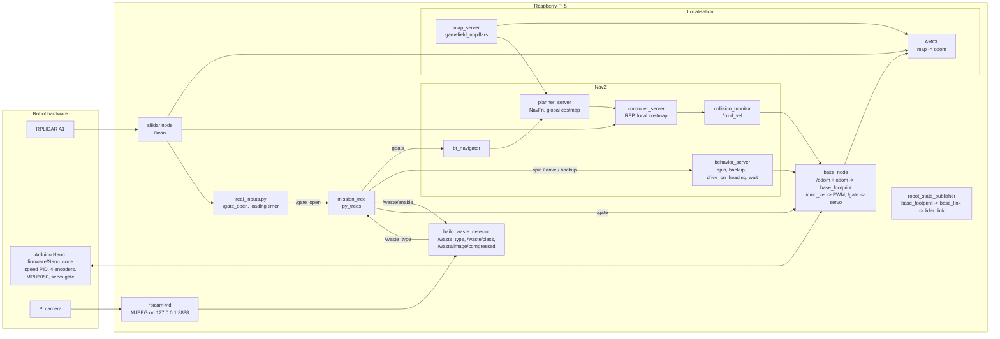

# Architecture

The robot answers three questions over and over: **where am I** (SLAM or AMCL), **how do I get there** (Nav2)
and **what do I do next** (the mission tree). Everything talks over ROS 2 topics on `ROS_DOMAIN_ID=7`
(Gazebo uses 8).



## Low level (Arduino Nano)

`base_node` sends `M <left> <right>` (-255..255, a fraction of top speed) and the Nano closes the loop on
wheel speed itself (PI on encoder ticks/s, feed-forward, soft start, gyro heading hold when driving straight,
stall cut-off, 500 ms command timeout). It streams `D,...` telemetry (IMU + 4 encoders) every 50 ms, which
`base_node` turns into `/odom`. Protocol and wiring: [firmware/README.md](../firmware/README.md).

## Frames (TF)

```
map --(AMCL or slam_toolbox)--> odom --(base_node)--> base_footprint --(robot_state_publisher)--> base_link --> lidar_link
```

Each link has exactly one publisher. A missing or doubled link gives "Failed to compute odom pose" or a map
that jumps. `base_node`'s `base_frame` must be `base_footprint`.

## Two modes

| Mode | Started by | Builds / uses | Publishes `map -> odom` |
|---|---|---|---|
| Mapping | `cramped_robot_description/launch/mapping.launch.py` | slam_toolbox `online_async`, loop closing **off**, drive with teleop, save with `map_saver_cli` | slam_toolbox |
| Navigation | `cramped_robot_description/launch/navigation.launch.py` | map_server loads `gamefield_nopillars`, AMCL localises against it | AMCL |

`gamefield_nopillars` is drawn from the field CAD, not from SLAM: it is straighter than any SLAM map
(`map_7` is rotated about 8 deg and its bottom wall drifted 10-15 cm). The gate is **not** drawn in it, on
purpose: it moves, the lidar sees it live.

## Nav2 (navigation)

| Part | Setting | Effect |
|---|---|---|
| bt_navigator | mission goals use `malkia_mission/bt/navigate_to_pose_no_spin.xml` and `navigate_through_poses_terrain.xml` | recoveries are clear costmaps, wait 5 s, back up 15 cm. **No spin** (RViz goals use Nav2's default tree, which does spin) |
| planner_server | NavFn over the global costmap, inflation 0.20 m, cost scaling 10 | paths run down the middle of the 60 cm lanes and swing wide round corners |
| controller_server | Regulated Pure Pursuit, 0.20 m/s, lookahead 0.35 m, rotate-to-heading on | follows the path, slows in tight turns |
| goal checker | xy 0.12 m, yaw 0.25 rad (14 deg) | "arrived"; the mission's AlignYaw / DockAt then square the robot up to 3 deg / 2 cm |
| collision_monitor | stop and slow-down polygons on `/scan` | last safety check before `/cmd_vel` |
| behavior_server | spin, backup, drive_on_heading, wait | used by the recoveries and by the mission's docking steps |

## Mission tree (`malkia_mission/mission_tree.py`)

Runs once, ticking at 5 Hz, as a Parallel of `ObstacleMonitor` (logs the first collision-monitor stop) and the
mission sequence:

| Stage | Steps |
|---|---|
| Detection | `GoToScreen` -> `AlignAtScreen` (square up to 3 deg) -> `DetectWasteType`: switch the detector on, majority vote on `/waste_type` (10 votes, 70 %), 2 tries x 8 s, else `waste_type_default` -> detector off |
| Loading | pick the chute for the type -> `GoToLoading` (through a corner checkpoint) -> `DockAtLoading` (square up, drive straight to tail 75 cm from the wall, square up) -> `LoadItem` (publish `/loading/request`, wait 5 s) |
| Route | `GoToJunction` (through corner checkpoints) -> wait up to 5 s for `/gate_open` (lidar) -> **path2** if open, else **path1** over the grass at 0.12 m/s |
| Depositing | `GoToBins` -> pick the bin -> `GoToBin` -> `DockAtBin` -> `Offload` (`/gate` true for 2.5 s, then false) |

Building blocks:

| Behaviour | What it does |
|---|---|
| `NavToPose` / `NavThroughPoses` | Nav2 actions with a goal from `mission.yaml` |
| `Leg` / `NavVia` | a leg that drives through the corner checkpoints listed under `via:` for that leg and waste type |
| `AlignYaw` | turns on the spot (Nav2 spin) until within `tol_deg` of the pose's yaw |
| `DockAt` | AlignYaw + drive straight forward or back (drive_on_heading / backup) onto the pose, + AlignYaw. Sideways error is only logged |
| `TopicVote` | majority vote over a topic, switches the detector on and off through `/waste/enable` |
| `WaitForBool` | waits for a fresh `true` (gate open) |
| `Offload` | opens the servo gate, holds, always closes again |

None of the alignment or docking steps can fail the mission: if TF or a Nav2 server is missing they log a
warning and carry on.

## Inputs

| Node | Publishes | How |
|---|---|---|
| `hailo_waste_detector.py` (systemd `waste-detector`) | `/waste_type` (one reading per frame, only while enabled), `/waste/class`, `/waste/station`, `/waste/image/compressed` | YOLO on the Hailo-8L, camera read locally from `rpicam-vid` |
| `real_inputs.py` | `/gate_open` at 5 Hz, `/loading/done` | gate CLOSED when 6 or more lidar points fall in the gate box (x 1.46-1.65, y -1.37 to -0.92) for 3 scans in a row; only judged within 1.5 m |
